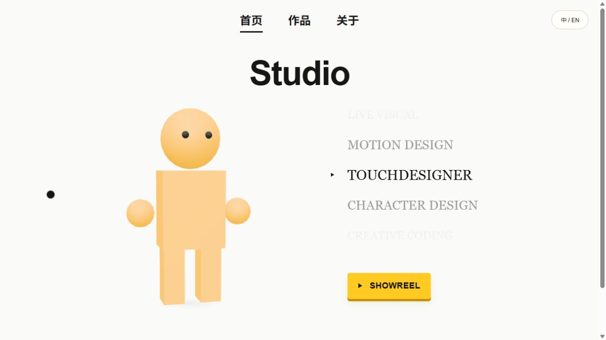

# Portfolio Studio Template

**一个可在本地可视化编辑的中英文创意作品集模板，基于 Astro 与 Three.js。**

**An editable bilingual creative portfolio template built with Astro and Three.js.**

[中文](#中文说明) · [English](#english)



## 中文说明

### 这是什么？

这是一个面向设计师、动画师、创意编程与视觉创作者的作品集起点。它将静态网站的发布方式与本地网页编辑器结合：在自己的电脑上编辑内容和排版，再构建成可部署的网站。

模板包含通用示例文字、程序生成的几何图片、3D 对象和演示视频，不包含原个人网站的照片、作品、联系方式、账号配置或访客数据。

> 当前仓库的实际工程位于 `portfolio-studio-template-v1.0/`。安装、开发和构建命令都需要在这个子目录中执行。

### 主要功能

- **互动首页**：Three.js 3D 对象、鼠标旋转、三种示例外观、分类滚轮与 SHOWREEL 入口。
- **作品管理**：分区、作品列表、排序、封面替换和图文 / 视频内容块。
- **可视化排版**：在本地拖动内容框、调整尺寸和间距，布局随 JSON 数据保存。
- **About 页面**：独立文本框、字号调整、拖动吸附、头像换图与四角裁切。
- **中英文切换**：双语标题和按帖子隔离的手工译文，便于保留自己的表达。
- **SHOWREEL 播放器**：ALL 与三个年份、深链接、平滑切换和首尾循环；圆环目录组件保留，可按需恢复。
- **心情贴纸**：本地可体验贴纸选择、留言、拖动、等比缩放、保存与本人撤回。线上共享需要额外配置后端。
- **响应式布局**：窄屏内容重排、竖图限高，以及适配手机阅读的 About 和作品页面。

### 快速开始

需要 **Node.js 22.18 或更高版本**，推荐 Node.js 24 LTS，并安装 npm。

先点击仓库的 **Use this template** 创建自己的仓库，或通过 **Code → Download ZIP** 下载并解压。进入下载或克隆后的仓库根目录，然后执行：

```sh
cd portfolio-studio-template-v1.0
npm ci
npm run dev
```

打开终端显示的本地地址，即可预览和使用编辑入口。停止开发服务时，在该终端按 `Ctrl+C`。

```sh
# 运行测试
npm test

# 生成静态网站
npm run build

# 预览正式构建
npm run preview
```

构建产物位于工程内的 `dist/`。正式构建不显示本地编辑按钮；修改源内容后，需要重新构建并发布。

### 从哪里修改？

下列路径均相对于 `portfolio-studio-template-v1.0/`。

| 要修改的内容 | 文件或入口 |
| --- | --- |
| 网站名称、线上贴纸开关 | `src/data/site.js` |
| 字号、颜色、边距、手机覆盖参数 | `src/styles/site-settings.css` |
| 作品与分类 | 本地网页编辑入口；`src/data/works.json`、`src/data/categories.json` |
| About 文字、头像及排版 | About → 编辑 About 排版；`src/data/about-portrait.json` |
| 联系方式 | `src/data/social-links.js` |
| 英文译文 | 本地「译文微调」；`src/data/translations.en.json` |
| 首页排版 | 本地「编辑首页排版」；`src/data/home-layouts.json` |
| SHOWREEL 视频 | `public/showreel/` 与 `src/data/portfolio.ts` |
| 3D 模型 | `public/models/` 与 `src/data/character-models.js` |

本地上传的素材保存在 `public/works/uploads/`。这些素材属于你自己的项目内容，分享源码前请检查其内容与授权。

### 它如何工作？

```text
内容与布局 JSON + Astro 页面与组件
                    ↓
       本地网页编辑器 → 校验并保存文件
                    ↓
              npm run build
                    ↓
                  dist/
                    ↓
                静态托管
```

Astro 负责生成页面，Three.js 负责 3D 显示，浏览器脚本负责交互。内容和布局使用 JSON 保存，通用视觉参数集中在 CSS 中。

编辑接口只在本地开发模式启用。它是个人创作工具，不是部署后供多人登录的在线 CMS。

### 部署与心情贴纸

将工程的 `dist/` 部署到静态托管平台即可展示作品集。若连接 Git 仓库构建，请将项目根目录设为 **`portfolio-studio-template-v1.0`**，构建命令设为 **`npm run build`**，输出目录设为 **`dist`**。

网站默认按域名根路径 `/` 设计。部署到 `/repo/` 这样的子路径时，需要进一步调整资源路径和路由，不能直接照搬。

在线共享贴纸需要自行配置 **Cloudflare Workers + D1**，或实现兼容的 `/api/moods` 接口。模板没有绑定任何个人账户；静态正式版默认关闭心情入口，本地开发仍可测试。完成后端配置后，可在 `src/data/site.js` 中启用 `sharedMoods`，再重新构建。

### 文档

- [完整搭建逻辑与流程](portfolio-studio-template-v1.0/docs/ARCHITECTURE.zh-CN.md)
- [部署与 GitHub 分享](portfolio-studio-template-v1.0/docs/DEPLOY.zh-CN.md)
- [公开分享前的检查](portfolio-studio-template-v1.0/docs/PRIVACY.zh-CN.md)
- [素材来源与第三方许可](portfolio-studio-template-v1.0/THIRD_PARTY_NOTICES.md)

### 许可与使用

模板代码和随附原创示例素材使用 [MIT License](portfolio-studio-template-v1.0/LICENSE)。第三方依赖遵循各自的许可证。替换为自己的字体、照片、音视频或模型后，请自行确认使用及再分发权限。

不要把 `.env`、登录凭据、访客数据库、备份或个人项目的旧 Git 历史提交到公开仓库。

欢迎在此基础上修改、学习和制作自己的作品集，也欢迎通过 Issues 反馈可复现的问题。

---

## English

### What is this?

A portfolio starter for designers, animators, creative coders, and visual artists. It combines a statically built website with local browser-based editing: edit content and layouts on your own computer, then build and deploy the result.

The template includes generic sample text, procedurally generated geometric images, 3D objects, and demo videos. It does not include the original personal site's photos, projects, contact details, account configuration, or visitor data.

> The application lives in `portfolio-studio-template-v1.0/`. Run installation, development, and build commands from that subdirectory.

### Features

- **Interactive home page**: a Three.js object, pointer-driven rotation, three sample appearances, a category wheel, and a SHOWREEL link.
- **Project management**: categories, galleries, ordering, cover replacement, and text / image / video content blocks.
- **Visual layout editing**: drag content frames and adjust dimensions and spacing locally; layouts are saved as JSON.
- **About page**: independent text frames, typography controls, drag snapping, avatar replacement, and four-corner clipping.
- **Chinese / English switching**: bilingual titles and manually editable translations scoped to individual projects.
- **SHOWREEL player**: an ALL reel, three yearly reels, deep links, smooth transitions, and circular navigation. The optional ring directory component is retained.
- **Mood stickers**: try sticker selection, messages, dragging, proportional resizing, saving, and owner-controlled removal locally. Shared online stickers require a backend.
- **Responsive layouts**: narrow-screen reflow, height limits for portrait images, and mobile-friendly About and project pages.

### Quick start

Requires **Node.js 22.18 or later** and npm. Node.js 24 LTS is recommended.

Choose **Use this template** to create your own repository, or download and extract the repository through **Code → Download ZIP**. From the downloaded or cloned repository root, run:

```sh
cd portfolio-studio-template-v1.0
npm ci
npm run dev
```

Open the local URL printed in the terminal. Local editing controls are available in development mode. Press `Ctrl+C` in that terminal to stop the server.

```sh
# Run tests
npm test

# Build the static website
npm run build

# Preview the production build
npm run preview
```

The build output is generated in the application's `dist/` directory. Production builds do not display local editing controls. Rebuild and redeploy after changing source content.

### Customization

Paths below are relative to `portfolio-studio-template-v1.0/`.

| Customize | File or entry point |
| --- | --- |
| Site name and shared sticker toggle | `src/data/site.js` |
| Typography, colors, spacing, and mobile overrides | `src/styles/site-settings.css` |
| Projects and categories | Local editor; `src/data/works.json` and `src/data/categories.json` |
| About content, portrait, and layout | Local About editor; `src/data/about-portrait.json` |
| Contact links | `src/data/social-links.js` |
| English translations | Local translation editor; `src/data/translations.en.json` |
| Home layout | Local home layout editor; `src/data/home-layouts.json` |
| SHOWREEL videos | `public/showreel/` and `src/data/portfolio.ts` |
| 3D models | `public/models/` and `src/data/character-models.js` |

Uploaded assets are stored in `public/works/uploads/`. Review the content and redistribution rights of your own assets before sharing your source code.

### How it works

```text
Content and layout JSON + Astro pages and components
                            ↓
       Local browser editor → Validate and save files
                            ↓
                      npm run build
                            ↓
                          dist/
                            ↓
                       Static hosting
```

Astro generates the pages, Three.js renders the 3D content, and browser scripts handle interaction. Content and layouts are stored in JSON; shared visual settings live in CSS.

Editing APIs are development-only. This is a local authoring tool, not a hosted multi-user CMS.

### Deployment and shared stickers

Deploy the application's `dist/` directory to a static hosting provider. For Git-connected builds, set the project root to **`portfolio-studio-template-v1.0`**, the build command to **`npm run build`**, and the output directory to **`dist`**.

The application assumes it is served at the domain root `/`. Hosting under a subpath such as `/repo/` requires additional asset-path and routing changes.

Shared online stickers require your own **Cloudflare Workers + D1** setup or a compatible `/api/moods` implementation. No personal account is configured. The static production build hides the mood entry by default; local development still supports testing. After setting up the backend, enable `sharedMoods` in `src/data/site.js` and rebuild.

### Documentation

- [Architecture and implementation workflow — Chinese](portfolio-studio-template-v1.0/docs/ARCHITECTURE.zh-CN.md)
- [Deployment and GitHub sharing — Chinese](portfolio-studio-template-v1.0/docs/DEPLOY.zh-CN.md)
- [Sharing and privacy checks — Chinese](portfolio-studio-template-v1.0/docs/PRIVACY.zh-CN.md)
- [English quick start](portfolio-studio-template-v1.0/docs/QUICKSTART.en.md)
- [Asset provenance and third-party notices](portfolio-studio-template-v1.0/THIRD_PARTY_NOTICES.md)

### License and use

The template code and included original demo assets are available under the [MIT License](portfolio-studio-template-v1.0/LICENSE). Third-party dependencies retain their own licenses. Check the usage and redistribution rights of any replacement fonts, photos, videos, audio, or models.

Do not commit environment files, credentials, visitor databases, backups, or private project history to a public repository.

You are welcome to adapt the template, learn from it, and build your own portfolio. Reproducible bug reports are welcome through Issues.
