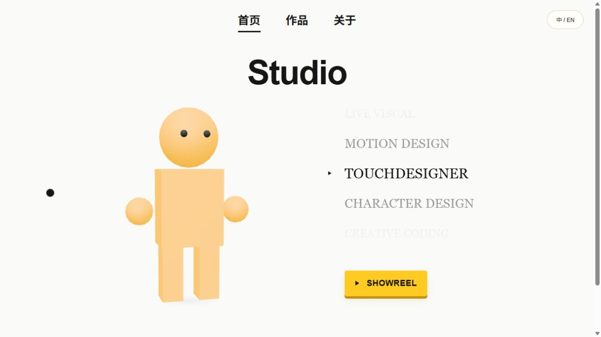

# Portfolio Studio Template

可本地可视化编辑的双语创意作品集模板。Astro 静态页面 + Three.js 互动对象 + JSON 内容 + 可选 Workers / D1 心情贴纸。

模板只含通用示例文字和程序生成的几何素材，不含原作者的个人内容、客户作品或账号配置。



## 快速开始

需要 Node.js 22.18+，建议 Node.js 24 LTS。先安装 Node.js 与 npm。

```sh
npm ci
node node_modules/astro/bin/astro.mjs dev --background
```

打开终端显示的 localhost 地址。不要在公网开放这个带文件写入能力的开发服务。

```sh
node node_modules/astro/bin/astro.mjs dev status
node node_modules/astro/bin/astro.mjs dev logs
node node_modules/astro/bin/astro.mjs dev stop
npm test
npm run audit:share
npm run build
npm run preview
```

`dist/` 是可部署的静态产物。`preview` 展示正式版，所以不显示编辑按钮。

## 已包含的能力

- 首页：GLB 对象、鼠标旋转、三种示例外观切换、分类滚轮、SHOWREEL 入口。
- Projects：分区、可调整顺序与尺寸的画廊、图文/视频内容块、自由画布。
- About：独立文本框、拖动吸附、字号调整、头像换图与四角裁切。
- 中英文：独立标题、按帖子隔离的手工译文、切换语言后重新计算文字高度。
- SHOWREEL：ALL 与三个年份、深链接、阻尼切换、首尾循环；保留可恢复的圆环目录。
- 心情贴纸：本地可测试；选择、拖动、等比缩放、保存、本人修改与撤回。在线共享需接后端。
- 手机：画廊自动排版、文字重排、竖图限高、About 顺序阅读、横屏视频布局。

## 从哪里改

| 目标 | 文件 / 入口 |
| --- | --- |
| 名称与线上贴纸开关 | `src/data/site.js` |
| 通用字号、间距与颜色 | `src/styles/site-settings.css` |
| 作品与分区 | 网页中的管理、编辑按钮；保存在 `src/data/works.json`、`categories.json` |
| About 头像与文字 | About → 编辑 About 排版；保存在 `about-portrait.json` |
| 联系方式 | `src/data/social-links.js`，当前只连接示例地址 |
| 中英文 | 作品信息双语标题 + 译文微调；`translations.en.json` |
| 首页布局 | 编辑首页排版；`home-layouts.json` |
| SHOWREEL 视频 | `public/showreel/` 与 `src/data/portfolio.ts` |
| 3D 模型 | `src/data/character-models.js` 与 `public/models/` |

上传文件保存到 `public/works/uploads/`；编辑产生的本地备份和访客数据库默认不会提交 Git。

## 文档

- [完整搭建逻辑与流程（中文）](docs/ARCHITECTURE.zh-CN.md)
- [部署与 GitHub 分享](docs/DEPLOY.zh-CN.md)
- [示例素材与依赖许可](THIRD_PARTY_NOTICES.md)
- [公开分享前的检查](docs/PRIVACY.zh-CN.md)
- [English quick start](docs/QUICKSTART.en.md)

## GitHub 共享

把本目录作为新仓库上传，保留 `package-lock.json`。不要上传 `node_modules`、构建缓存、运行时数据库、备份或登录信息。建立新仓库历史，不要把个人站点的旧 Git 历史推上来。

仓库公开后，可在 Settings → General → Template repository 标记为模板。代码采用 MIT；依赖遵循各自许可证。添加自己的图片、字体、音视频和模型前，请确认自己有再分发权。
